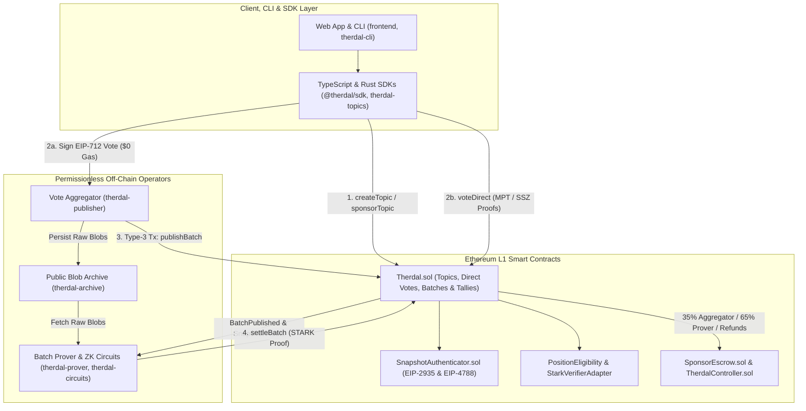
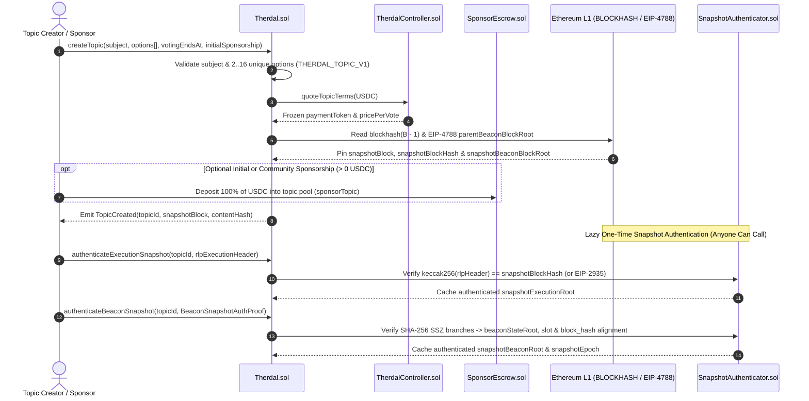
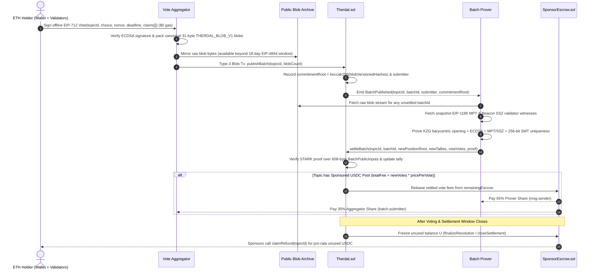
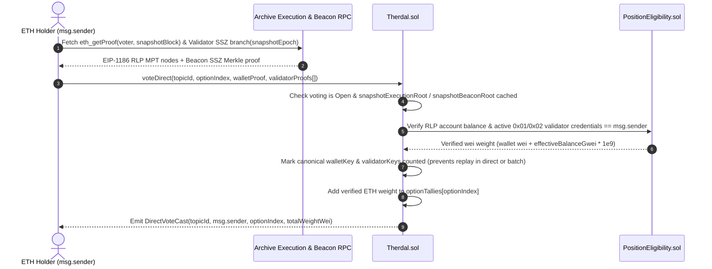

# Therdal Protocol — System Architecture & Sequence Flows

## 1. Architectural Overview

Therdal decouples **topic creation**, **voter signing**, **batch publication**, and **cryptographic tally settlement** across three modular layers so no off-chain actor is trusted, ETH is never locked, and ETH holders can signal offline for `$0` gas:

1. **Client, CLI & SDK Layer (`frontend/`, `sdk/`, `cli/`, `topics/`, `voting/`)**:
   - Deterministic `THERDAL_TOPIC_V1` topic validation and commitment hashing across TypeScript, Rust, and browser UIs.
   - Offline EIP-712 `Vote` envelope signing (allowing cold hardware wallets and validator withdrawal addresses to sign safely offline).
   - Direct on-chain proof builders for EIP-1186 execution balance proofs and Beacon `0x01`/`0x02` validator SSZ inclusion branches.
2. **Permissionless Off-Chain Operator Layer**:
   - **Vote Aggregator (`publisher/`, `archive/`)**: Hosts voting frontends, pre-validates ECDSA signatures, packs signed ballots into canonical 31-byte `THERDAL_BLOB_V1` EIP-4844 blobs, mirrors raw blobs on a public HTTP/IPFS archive, and calls `publishBatch` on Ethereum L1.
   - **Batch Prover (`prover/`, `circuits/`)**: Reads published blobs (in any non-sequential order), constructs historical execution MPT and beacon SSZ witnesses at the topic's pinned snapshot block, binds KZG blob commitments via barycentric evaluation, updates the 256-bit Sparse Merkle Tree (`positionRoot`), and submits a STARK validity proof to `settleBatch`.
3. **Ethereum L1 Settlement & Escrow Layer (`contracts/`)**:
   - **`Therdal.sol`**: Topic registry, parent-block snapshot pinning, direct on-chain voting, EIP-4844 batch registration, and STARK-verified tally settlement.
   - **`SnapshotAuthenticator.sol`**: Authenticates `snapshotExecutionRoot` (via `BLOCKHASH` / EIP-2935 RLP header verification) and `snapshotBeaconRoot` + `snapshotEpoch` (via EIP-4788 + SHA-256 SSZ Merkle alignment).
   - **`PositionEligibility.sol` & `StarkVerifierAdapter.sol`**: Verifies RLP MPT wallet balances, SSZ validator active stake & `0x01`/`0x02` withdrawal credentials, and the 608-byte `BatchPublicInputs` digest.
   - **`SponsorEscrow.sol` & `TherdalController.sol`**: Holds optional sponsored USD stablecoin pools (defaulting to 6-decimal USDC), freezes per-topic `pricePerVote` at creation, distributes settled vote fees (**35% Vote Aggregator** / **65% Batch Prover**), and unlocks pro-rata pull refunds for unused escrow.

### Layered Component Topology

---

## 2. Sequence 1: Topic Creation, Sponsorship & Snapshot Authentication

Creating a topic pins the parent Ethereum execution block hash (`block.number - 1`) and EIP-4788 parent beacon block root immediately at creation for minimal gas. Full execution `stateRoot` and beacon `BeaconState` roots are authenticated lazily once before the first vote or batch settles.

---

## 3. Sequence 2: Offline EIP-712 Voting, EIP-4844 Aggregation & STARK Settlement

In the primary gas-free flow, ETH holders sign a single offline EIP-712 ballot claiming their execution wallet balance and any controlled `0x01`/`0x02` validators. Permissionless aggregators pack ballots into EIP-4844 blobs, and permissionless provers verify batch transitions out-of-order to earn rewards from the topic's sponsored USDC pool.

---

## 4. Sequence 3: Direct On-Chain Voting (Censorship-Resistant Bypass)

If an ETH holder prefers not to use an aggregator—or if all frontends censor their ballot—they can submit historical snapshot proofs directly to `Therdal.sol` (`$0` protocol fee; voter pays only standard Ethereum L1 gas).

---

## 5. Cross-Layer Deterministic Domain Commitments

Every cryptographic hash and binary framing rule is version-tagged and tested against shared deterministic vectors across Solidity (`contracts/`), Rust (`topics/`, `voting/`, `circuits/`, `publisher/`, `prover/`), and TypeScript (`sdk/`, `frontend/`):

| Domain Tag / Magic | Layer Scope | Specification Purpose |
| --- | --- | --- |
| `THERDAL_TOPIC_V1` | `TopicValidation.sol`, `therdal-topics`, `@therdal/sdk`, `frontend/` | Canonical 96-byte outer preimage hashing `subject`, `options[]`, and `votingEndsAt` into `contentHash` |
| `THERDAL_WALLET` | `PositionEligibility.sol`, `circuits/`, `voting/` | Position uniqueness key `keccak256("THERDAL_WALLET", chainId, account)` |
| `THERDAL_VALIDATOR` | `PositionEligibility.sol`, `circuits/`, `voting/` | Validator uniqueness key `keccak256("THERDAL_VALIDATOR", chainId, validatorIndex)` |
| `THERDAL_SMT_LEAF_V1` | `StarkVerifierAdapter.sol`, `circuits/`, `prover/` | 256-bit Sparse Merkle Tree occupied leaf digest preventing double-counting across batches |
| `THDLBLOB` (`THERDAL_BLOB_V1`) | `BatchRegistry`, `publisher/`, `archive/`, `circuits/` | Canonical 31-byte BLS12-381 field element stream header & length-prefixed `VoteRecord` framing |
| `THERDAL_BARYCENTRIC_V1` | `circuits/src/blob_binding.rs`, `prover/` | Fiat-Shamir evaluation challenge binding decoded blob bytes to EIP-4844 `0x01` KZG commitments |
| `THERDAL_PUBLIC_INPUTS_V2` | `StarkVerifierAdapter.sol`, `circuits/src/batch_transition.rs` | Canonical 19-word (`608`-byte) public input digest verified on Ethereum L1 |
